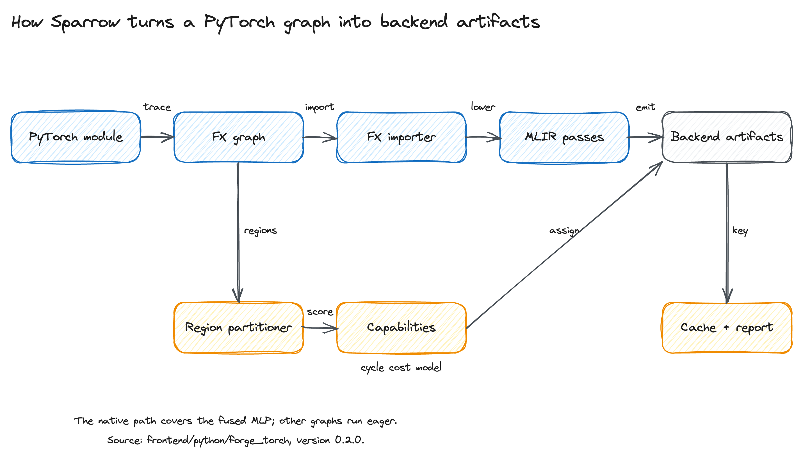
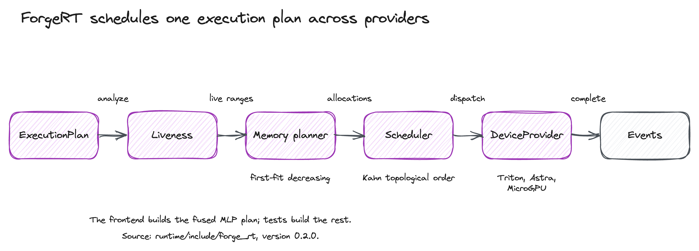

# Sparrow

Sparrow is a PyTorch-to-MLIR compiler and C++ runtime for three CPU backends.
It is a research-scale stack for compiler and runtime engineers who need to
read every layer.

Version 0.2.0 is a baseline. The frontend imports and caches graphs and returns
an eager callable by default. A native fused-MLP path runs through ForgeRT when
the pybind11 module is built. General graphs do not get a runtime plan yet.
[docs/SPEC.md](docs/SPEC.md) states each contract and marks each one met,
partial, or gap; [docs/AUDIT.md](docs/AUDIT.md) records the evidence and the
remediation order.

## Quick start

```bash
devenv shell
python3 -c "import torch, xdsl; print(torch.__version__, xdsl.__version__)"
```

On a host without `devenv`, use the venv path:

```bash
bash scripts/setup-env.sh
source .venv/bin/activate
python3 -c "import torch, xdsl; print(torch.__version__, xdsl.__version__)"
```

Run the frontend on the fused MLP fixture:

```bash
python3 - <<'PY'
import torch
from forge_torch.backend import compile


class FusedMLP(torch.nn.Module):
    def forward(self, x, weight, bias):
        return torch.nn.functional.gelu(x @ weight + bias)


model = FusedMLP()
x = torch.randn(2, 8, 128)
w = torch.randn(128, 256)
b = torch.randn(256)

compiled = compile(model, [x, w, b])
out = compiled(x, w, b)
print("shape", tuple(out.shape), "lowered", compiled.lowered)
PY
```

```text
shape (2, 8, 256) lowered False
```

`lowered` is `False` in a plain dev shell. The callable then executes the eager
model, and the import, cache, and report steps still run. Build the optional
native module (`cmake -B build -S . -G Ninja && cmake --build build`, then set
`PYTHONPATH=build/python`) to run this fused MLP through the C++ kernel and get
`lowered True`. The kernel is a naive triple loop, so large shapes fall back to
eager.

## Backends

| Backend | Implemented | Limit |
| --- | --- | --- |
| Triton-CPU | fp32 fused GEMM, bias, and GELU C++ kernel, provider | 2D input, one output |
| Astra-sim | 64-bit microcode ISA, assembler, functional and timing simulators, provider | 16x16 tile; codegen is not usable |
| MicroGPU-sim | 16-bit SIMT ISA, assembler, interpreter, provider | No lowering pass; one input |

The registry is narrowed to ops with a dialect definition. The compiler
lowering map is empty, so `partition()` raises instead of assigning a region it
cannot lower. The native bridge covers the fused MLP on Triton-CPU; general
graphs run eager.

## Architecture

Sparrow separates the compile path from the runtime path.



The frontend captures an FX graph, imports it as MLIR, and partitions FX
regions with a capability and cost model. The compiler lowers and optimizes the
MLIR. Backend artifacts and the cache sit at the end of that path.



ForgeRT takes an execution plan, computes liveness and buffer reuse, orders the
nodes, and dispatches each launch to a provider. The providers are Host-only
and synchronous.

The frontend builds a one-node execution plan for the fused MLP slice. General
graphs do not get one, so the two figures describe one design whose halves meet
only for that slice. The specification marks the rest as gaps.

## Checks

```bash
bash scripts/probe-env.sh
bash scripts/ci.sh
```

The probe names every missing tool. The gate chains the C++ build and ctest,
lit, pytest, ruff, and ty. It expects the environment from
`scripts/setup-env.sh` and is not hermetic yet. Read
[docs/AUDIT.md](docs/AUDIT.md) before relying on it.
